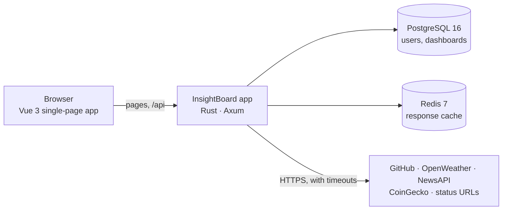

# InsightBoard

**Build personal dashboards from live data: GitHub activity, weather, news, crypto prices, and website status, arranged on a drag-and-drop grid.**

[](https://github.com/lavinhoque33/insightboard/actions/workflows/ci.yml)
[](LICENSE)

<picture>
  <source media="(prefers-color-scheme: dark)" srcset="docs/assets/screenshots/editor-dark.webp">
  
</picture>

InsightBoard is a self-hosted dashboard builder. Sign up, create as many dashboards as you like, and fill them with
widgets that pull data from public APIs. A Rust backend fetches and caches every provider call, so API keys never
reach the browser and repeated views stay fast. It runs entirely on your own machine with a single `make up`.

## Highlights

- **Five widget types:** GitHub activity, current weather, news headlines, cryptocurrency prices, and an uptime
  checker for your own URLs.
- **Drag-and-drop editor:** a 12-column grid with move and resize; changes save automatically, and a failed save is
  shown with a Retry button instead of being lost.
- **Private by default:** each account sees only its own dashboards; passwords are hashed with Argon2.
- **Fast and frugal:** provider responses are cached in Redis (2–15 minutes per widget), shared across users where
  the data is public, and rate-limited per user.
- **Safe outbound calls:** every request has a timeout, user input is encoded, and the status widget refuses
  loopback, private, link-local, and cloud-metadata addresses.
- **Polished interface:** light and dark themes that follow your system, a responsive layout down to phone width,
  keyboard-reachable menus and dialogs, and reduced-motion support.
- **One container:** the backend serves the built frontend, so the app is a single image beside Postgres and Redis.

| Dashboards | Configure a widget | On a phone | Sign in |
| --- | --- | --- | --- |
|  |  |  |  |

<sub>Screenshots show demo data.</sub>

## Quick start

You need Docker with the Compose plugin, `make`, `openssl`, `awk`, and Git. No Rust or Node installation is
required.

```sh
git clone https://github.com/lavinhoque33/insightboard.git
cd insightboard
make setup-env   # creates .env with generated database, Redis, and JWT secrets
make release     # builds the insightboard:local image
make up          # starts Postgres, Redis, and the app, and waits until they are healthy
```

Open <http://127.0.0.1:8088>, create an account, and add your first dashboard. `make down` stops everything and
keeps your data; `make up` brings it back.

### Provider keys

GitHub, crypto, and status widgets work without any key. Weather and news need free API keys:

| Variable in `.env` | Get it from | Needed for |
| --- | --- | --- |
| `OPENWEATHER_API_KEY` | [OpenWeather](https://openweathermap.org/api) (free tier) | Weather widget |
| `NEWSAPI_API_KEY` | [NewsAPI](https://newsapi.org/) (free developer plan) | News widget |
| `GITHUB_API_TOKEN` | [GitHub personal access token](https://github.com/settings/tokens) (optional) | Higher GitHub rate limits |

After editing `.env`, run `make up` again. Without a key, the affected widget shows a clear "not configured" message.

## Widgets

| Widget | You enter | Shows | Data source | Refresh |
| --- | --- | --- | --- | --- |
| GitHub | A username | Recent public events: pushes, pull requests, issues, stars, new repositories | GitHub REST API | 5 min |
| Weather | A city | Temperature, conditions, feels-like, humidity, wind | OpenWeather | 10 min |
| News | A topic | Latest headlines with source and age | NewsAPI | 15 min |
| Crypto | CoinGecko ids, e.g. `bitcoin,ethereum` | Price, 24 h change, market cap, volume | CoinGecko | 5 min |
| Status | Up to 10 URLs | HTTP status and response time per URL | Direct checks from the server | 2 min |

## How it works



- The browser loads the app and talks only to the backend, on one origin.
- The backend authenticates requests with a JWT, stores users and dashboard layouts in Postgres, and proxies each
  widget's data request to its provider, caching the normalised result in Redis.
- Dashboard layouts are stored as JSON and validated against a shared [JSON Schema contract](contracts/api-contract.v1.json)
  that both the backend and the frontend test against.
- Database migrations are embedded in the backend and run on startup.

## Tech stack

| Layer | Technologies |
| --- | --- |
| Backend | Rust 2021, Axum 0.7, Tokio, SQLx 0.8 (PostgreSQL), redis-rs 0.27, reqwest 0.12, Argon2, jsonwebtoken, tower-http |
| Frontend | Vue 3.5, TypeScript 5.9, Vite 7, Pinia, Vue Router, GridStack 10, Tailwind CSS 4, daisyUI 5 |
| Data | PostgreSQL 16, Redis 7 (append-only) |
| Testing | `cargo test` (with real Postgres and Redis), Vitest, Playwright, JSON Schema contract tests |
| Delivery | Multi-stage Dockerfile, Docker Compose, Make, GitHub Actions |

## API

All `/api` routes except sign-up and sign-in need `Authorization: Bearer <token>`. Errors are JSON,
`{"error": "..."}`; validation errors (422) add `details` naming each invalid field.

| Method and path | Purpose |
| --- | --- |
| `POST /api/auth/register`, `POST /api/auth/login` | Create an account or sign in; returns a token and the user |
| `GET /api/me` | The signed-in user |
| `GET`, `POST /api/dashboards` | List or create your dashboards |
| `GET`, `PUT`, `DELETE /api/dashboards/{id}` | Read, update (name, layout, settings), or delete one dashboard |
| `GET /api/data/{github,weather,news,crypto,status}` | Widget data, e.g. `/api/data/weather?city=Lisbon` |
| `GET /healthz`, `GET /readyz` | Liveness (with version) and readiness (Postgres and Redis reachable) |

Payload shapes are defined in [`contracts/api-contract.v1.json`](contracts/api-contract.v1.json).

## Development

For working on the code you also need Node 20.19 or newer (see `.nvmrc`) and, optionally, Rust (the version is
pinned in `rust-toolchain.toml`; backend checks fall back to a container without it).

```sh
make setup        # installs frontend dependencies; creates .env if it is missing
make db-up        # Postgres and Redis in Docker
make backend-dev  # terminal 1: API on http://127.0.0.1:8080, migrations applied
make web-dev      # terminal 2: Vite dev server on http://127.0.0.1:5173
```

`make help` lists every target. The full guide, including configuration variables and troubleshooting, is in
[local setup](docs/development/local-setup.md).

### Testing

```sh
make verify   # rustfmt, clippy, backend tests, ESLint, Prettier, Vitest, type-check, production build
make e2e      # Playwright browser journeys (first run: cd frontend && npx playwright install chromium)
```

Backend tests run against the Docker Postgres and Redis, so start them with `make db-up` first. Provider calls in
tests go to local mock servers; no test touches a real third-party API. GitHub Actions runs the backend, frontend,
end-to-end, Docker-image, and infrastructure-synth jobs on every push. See [testing](docs/development/testing.md) for
details.

## Security and privacy

- Every service listens on `127.0.0.1` only; nothing is reachable from your network.
- Secrets are generated locally into `.env` (mode 600), which is ignored by Git and excluded from the image. The
  container runs as a non-root user.
- Passwords are hashed with Argon2; tokens expire after 24 hours; sign-in and data requests are rate-limited.
- Provider keys stay on the server, and error messages returned to the browser never include upstream details.

## Limitations

- Designed for one person on one machine: plain HTTP on loopback and a single instance. TLS to a remote Postgres or
  Redis is supported ([configuration](docs/development/local-setup.md#configuration)), but the app itself serves
  plain HTTP.
- The session token is kept in the browser's `localStorage` for 24 hours; there is no token refresh or server-side
  revocation.
- Anyone who can reach the port can register, and all browsers share one sign-in rate limit.
- There are no automatic backups; `make backup` writes a database dump on demand.
- Moving and resizing widgets needs a mouse or touch screen.

## Project structure

```text
backend/             Rust API: handlers, models, widget providers, auth, cache, config
backend/migrations/  SQL migrations, embedded and applied at startup
frontend/            Vue 3 + TypeScript client; e2e/ holds the Playwright tests and provider mock
contracts/           JSON Schema for API payloads, shared by both test suites
docs/                Architecture, operations runbook, development guides, decisions
Dockerfile           Release image: the backend serving the built frontend
infra/               Synth-only AWS CDK definition of a possible cloud experiment; nothing is deployed
docker-compose.yml   Postgres, Redis, and the app (profile "app")
Makefile             Setup, development, checks, and release commands
```

## Documentation

- [Runbook](docs/operations/runbook.md): running, upgrading, backing up and restoring, rotating secrets,
  troubleshooting.
- [Local setup](docs/development/local-setup.md) and [testing](docs/development/testing.md): developing and checking
  the code.
- [System overview](docs/architecture/system-overview.md): components, data flow, and boundaries.
- [Changelog](CHANGELOG.md) and [roadmap](docs/product/roadmap.md): what shipped and what comes next.
- [Documentation index](docs/index.md): everything else, including design decisions and verification records.

## License

[MIT](LICENSE) © 2025–2026 lavinhoque33. Questions: `ihoque33@yahoo.com`.
