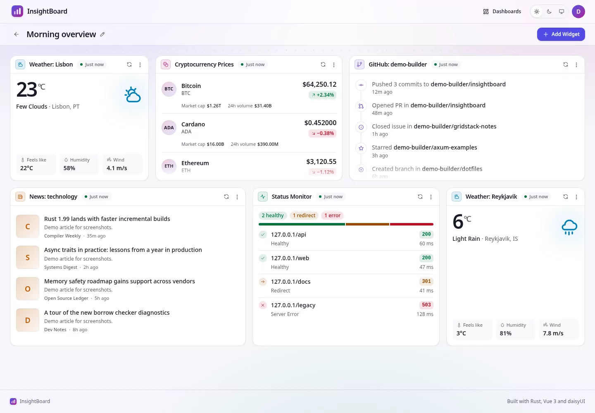
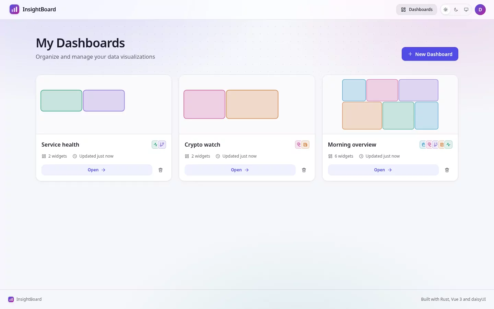
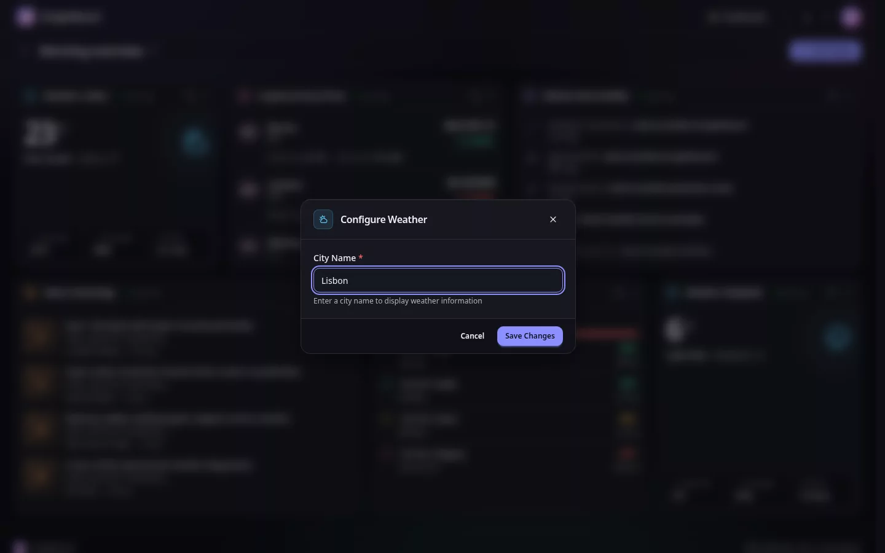
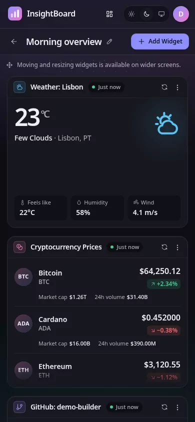
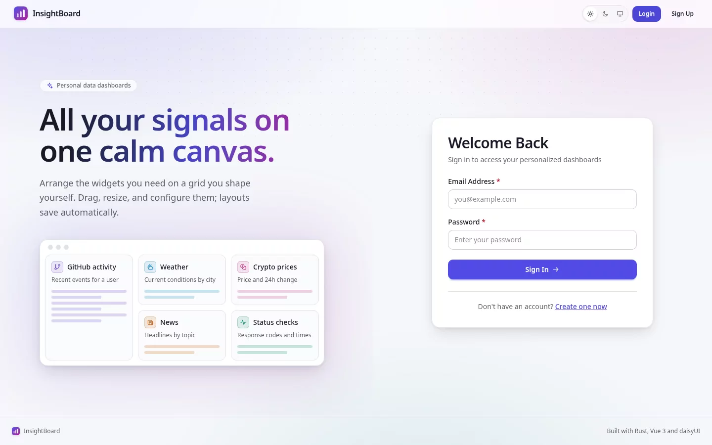

# InsightBoard

InsightBoard is a personal dashboard builder. You register, create dashboards, and arrange widgets on a
drag-and-drop grid; each widget shows data from a public provider, fetched and cached by the backend. It is a
Rust/Axum API backed by Postgres and Redis, with a Vue 3 and TypeScript client. Everything runs on your own machine;
nothing is deployed.

- **$0 of spending.** Free provider tiers only, with keys you supply; no cloud resources.
- **Local only.** Every service listens on `127.0.0.1`; nothing is reachable from the network.

**Status:** M0–M4 are **accepted** (2026-10-10). M5 — local release is **in progress** under its
[contract](docs/architecture/m5-local-release-contract.md) ([ADR 0003](docs/decisions/ADR-0003-m5-local-release.md)).
See the [roadmap](docs/product/roadmap.md) and the [changelog](CHANGELOG.md).

<picture>
  <source media="(prefers-color-scheme: dark)" srcset="docs/assets/screenshots/editor-dark.webp">
  
</picture>

| Dashboards | Configure a widget | 390 px | Sign in |
| --- | --- | --- | --- |
|  |  |  |  |

Screenshots use demo data from a local fixture, not live providers.

## Features

- **Accounts:** register and sign in with email and password (Argon2); sessions last 24 hours and return you to the
  page you asked for.
- **Dashboards:** create, rename, open, and delete your own dashboards; other users' dashboards are invisible.
- **Widgets:** five types, each fetched through the backend and cached in Redis:

  | Widget | Input | Provider | Cache |
  | --- | --- | --- | --- |
  | GitHub | `username` | GitHub public events (optional token) | 5 min |
  | Weather | `city` | OpenWeather current weather (free key) | 10 min |
  | News | `topic` | NewsAPI everything (free key) | 15 min |
  | Crypto | CoinGecko ids | CoinGecko markets, no key | 5 min |
  | Status | up to 10 URLs | a GET to each public `http`/`https` URL | 2 min, per user |

- **Editor:** a 12-column GridStack grid with drag and resize (one read-only column below 768 px). Adding a widget
  opens its configuration first; editing shows the current settings. Changes save automatically; a failed save
  says so and offers Retry.
- **Interface:** light and dark themes that follow your system, with a Light/Dark/System switch; keyboard-reachable
  menus and dialogs; reduced motion respected.

## Run the release (Docker only)

Needs Docker with Compose, `make`, `openssl`, and Git; no Rust or Node on the host.

```sh
git clone https://github.com/lavinhoque33/insightboard.git
cd insightboard
make setup-env   # .env with generated secrets (mode 600); provider keys left empty
make release     # builds the insightboard:local image
make up          # Postgres, Redis, and the app; waits until healthy
```

Open `http://127.0.0.1:8088`. Stop with `make down` (data is kept). Weather and News need free keys from OpenWeather
and NewsAPI in `.env`; run `make up` again after adding them. Backups, upgrades, secret rotation, and
troubleshooting are in the [runbook](docs/operations/runbook.md).

## Develop

Needs Docker with Compose, Node 20.19.0 (`.nvmrc`), `make`, `openssl`, and Rust (pinned by `rust-toolchain.toml`;
`make backend-check` falls back to a container without it). Details are in
[local setup](docs/development/local-setup.md).

```sh
make setup        # npm ci; creates .env with generated secrets if it is absent
make db-up        # Postgres 16 and Redis 7 on 127.0.0.1
make backend-dev  # terminal 1: applies migrations, serves 127.0.0.1:8080
make web-dev      # terminal 2: http://127.0.0.1:5173
```

The development servers and the release app share one database.

## Checks

`make verify` runs every gate: rustfmt, clippy, cargo test, ESLint, Prettier, Vitest, type-check, and build. Backend
tests use the compose Postgres and Redis, so run `make db-up` first. `make e2e` runs the Playwright journeys against
a loopback provider fixture (one-time `cd frontend && npx playwright install chromium`). GitHub Actions runs the
backend, web, e2e, and release jobs on every push to `main`. No automated test calls a live provider. Commands and
current results are in [testing](docs/development/testing.md).

## Limits

- Loopback only and plain HTTP; no TLS between the app, Postgres, and Redis (D21, planned for M6).
- The session token lives in the browser's `localStorage` for 24 hours, with no refresh or revocation.
- Anyone who can reach the port can register; all clients share one sign-in rate-limit bucket.
- One instance on one machine; no automatic backups (`make backup` is manual).
- Weather and News need your own free provider keys.
- The status widget checks only public `http`/`https` addresses; loopback, private, link-local, and metadata
  addresses are refused.
- Moving and resizing widgets needs a mouse or touch; keyboard layout editing is in the backlog.

The defect catalogue D1–D31 and how each was resolved are in the
[M0–M3 baseline contract](docs/architecture/m0-m3-baseline-contract.md) section 12.

## Where to start

1. The [documentation index](docs/index.md).
2. [.omp/AGENTS.md](.omp/AGENTS.md) and [CODING_PRACTICES.md](CODING_PRACTICES.md): how work is done here.
3. The [session handoff](docs/development/session-handoff.md) for the current checkpoint, then the
   [roadmap](docs/product/roadmap.md) and the [project plan](INSIGHTBOARD_PROJECT_PLAN.md).

## Layout

```text
backend/            Rust crate insightboard-backend: src/{handlers,models,widgets}, auth, cache, config, db, error
backend/migrations/ SQL migrations, embedded and applied at startup
frontend/           Vue 3 + TypeScript + Vite client; e2e/ holds the Playwright journeys and provider fixture
contracts/          api-contract.v1.json (JSON Schema, payload shapes), enforced by tests on both sides
docs/               product, architecture, decisions, development, operations, guides (non-authoritative)
Dockerfile          release image: the backend serving the built frontend
docker-compose.yml  Postgres and Redis; the app under the `app` profile
Makefile            release, development, checks (make help)
.github/workflows/  CI: backend, web, e2e, release
```

License: [MIT](LICENSE). Repository:
[github.com/lavinhoque33/insightboard](https://github.com/lavinhoque33/insightboard) (public). Contact:
`ihoque33@yahoo.com`.
