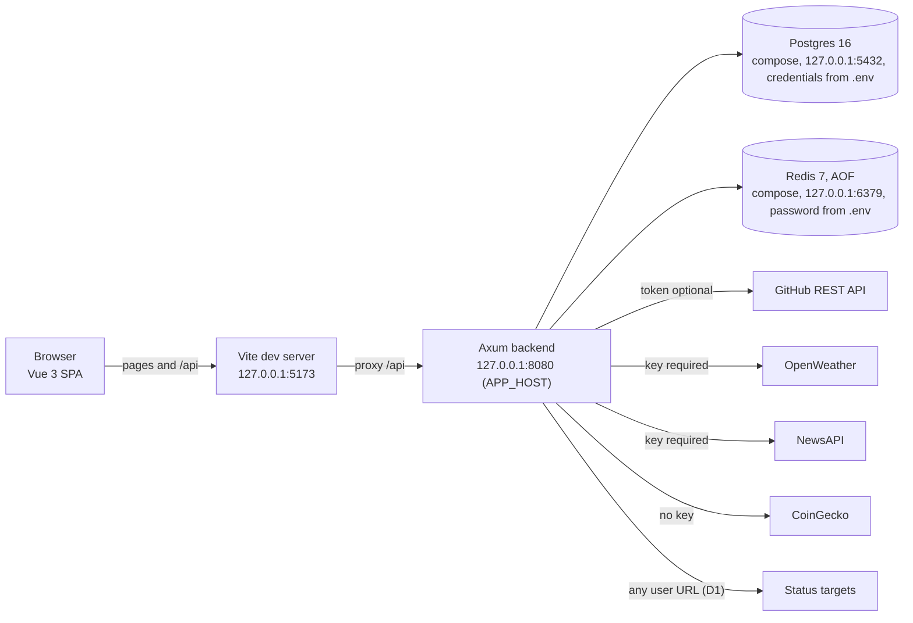
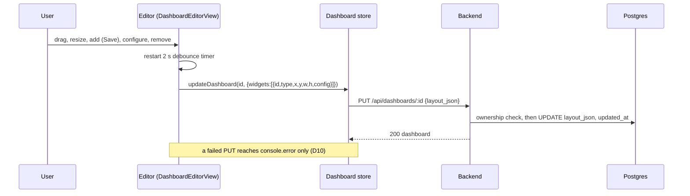

# System overview

The runtime shape of InsightBoard as built at `f15c6a3` (M0–M3), and the boundaries later milestones must
preserve or restore. Product direction is in the [project plan](../../INSIGHTBOARD_PROJECT_PLAN.md) (sections 6–10);
status is in the [roadmap](../product/roadmap.md); exact behaviour, status codes, and the defect list are in the
[M0–M3 baseline contract](m0-m3-baseline-contract.md).

## Components



- The backend and frontend run natively; Postgres and Redis are the only containers (`docker-compose.yml`). There is
  no Dockerfile, no production build path, and no CI.
- The browser talks only to the Vite dev server; Vite proxies `/api` to `http://127.0.0.1:8080`. The backend also
  answers cross-origin requests from anywhere (`CorsLayer::permissive()`, D4).
- Every provider call is made by the backend. Keys live in the backend environment and never reach the browser.

## Request flows

### Auth

1. `POST /api/auth/register` or `/api/auth/login` with `{email,password}`.
2. The backend hashes (register) or verifies (login) with Argon2 and returns `{token, user}`; the token is an HS256
   JWT valid for 7 days.
3. The client stores `auth_token` and `user` in localStorage; the router treats their presence as "authenticated".
4. Every later request carries `Authorization: Bearer <token>`; the `UserCtx` extractor validates it.
5. A 401 outside login and register clears storage and reloads at `/login` (D23).

### Dashboard save



New dashboards are created from the list with `name` "New Dashboard", an empty layout, and
`settings_json = {title, theme}`.

### Widget data with cache

```mermaid
sequenceDiagram
    participant W as Widget component
    participant B as Backend data endpoint
    participant R as Redis
    participant X as Provider
    W->>B: GET /api/data/<type>?<param> (on mount, on interval, on config change)
    B->>B: validate input; check provider key (weather, news)
    B->>R: GET <type>:<input>
    alt cache hit
        R-->>B: JSON
    else miss or Redis error
        B->>X: HTTPS request (no timeout except status, D5)
        X-->>B: response
        B->>R: SET <key> EX <ttl> (errors ignored)
    end
    B-->>W: normalised JSON, or 400 / 502 {error}
```

## Data model

| Table | Columns | Notes |
| --- | --- | --- |
| `users` | `id` uuid pk, `email` unique, `password_hash`, `created_at` | Email stored as entered (D17) |
| `dashboards` | `id` uuid pk, `user_id` fk → users (cascade), `name`, `layout_json` jsonb default `'[]'`, `settings_json` jsonb default `'{}'`, `created_at`, `updated_at` | Every query filters by `user_id`; JSON shapes not enforced (D8) |

Migrations are embedded in the binary and applied at startup. Widget configuration lives inside `layout_json`;
there is no widget table.

## Cache keys and TTLs

| Endpoint | Key | TTL | Client refresh |
| --- | --- | --- | --- |
| `/api/data/github` | `github:{username}` | 300 s | 300 s |
| `/api/data/weather` | `weather:{city}` | 600 s | 600 s |
| `/api/data/news` | `news:{topic}` | 900 s | 900 s |
| `/api/data/crypto` | `crypto:{normalised ids}` | 300 s | 60 s (D27) |
| `/api/data/status` | `status:{raw urls}` | 120 s | 120 s |

Keys are shared across users and unbounded (D29). Redis is required at startup and optional per request (D19).

## Auth and session

- Local accounts only; no refresh token, revocation, roles, or Cognito.
- Tokens carry `sub`, `email`, `exp`, `iat`; the extractor does not re-check that the user exists (D17).
- The client never checks token expiry and never calls `/me` (D23).

## Configuration

Backend variables, defaults, and the variables documented but unread are listed in the
[baseline contract](m0-m3-baseline-contract.md) section 4. Required: `DATABASE_URL`, `REDIS_URL`, `JWT_SECRET`.
Optional provider credentials: `GITHUB_API_TOKEN`, `OPENWEATHER_API_KEY`, `NEWSAPI_API_KEY`. Frontend:
`VITE_API_URL` (default `/api`). Setup steps are in [local setup](../development/local-setup.md).

## Ports and binds

| Service | Port | Bind | Credentials |
| --- | --- | --- | --- |
| Backend (axum) | 8080 (`APP_PORT`) | `APP_HOST`, default `127.0.0.1` (`backend/src/config.rs`) | API only |
| Postgres | 5432 | `127.0.0.1:5432` (`docker-compose.yml`) | `POSTGRES_USER` / `POSTGRES_PASSWORD` from `.env` |
| Redis | 6379 | `127.0.0.1:6379` (`docker-compose.yml`) | `REDIS_PASSWORD` from `.env` |
| Vite dev server | 5173 | `127.0.0.1` (`frontend/vite.config.ts`) | n/a |

M4 decision 4 (owner-approved 2026-10-10) landed these loopback binds and credentials as the B0 mitigation for
**D3**: **implemented but unverified**, no drill has run. Setting `APP_HOST` to a non-loopback address is a
deliberate owner-approved change and is not blocked by code. CORS stays permissive (D4, decision 7).

## Boundaries

As built, enforced by code:

- Dashboards are owner-scoped in every query; a foreign id returns 404.
- Provider keys stay in the backend; responses are normalised before reaching the client.
- Error bodies do not carry database or provider error text, except the status widget's per-URL error (D1) and the
  JWT error kind (D17).

Required by the [plan](../../INSIGHTBOARD_PROJECT_PLAN.md) section 4 and not yet enforced by code (M4):

- Loopback-only listeners for the backend, Postgres, Redis, Vite, and fixtures (D3).
- Outbound requests limited by scheme, address class, count, and time; user input encoded (D1, D2, D5, D7).
- No live providers in automated paths; tests use local mocks with configurable base URLs (D11).
- Secrets never logged (D7).

## Known gaps

By area; each ID is defined in the [baseline contract](m0-m3-baseline-contract.md) section 12.

| Area | Defect IDs |
| --- | --- |
| Exposure and CORS | D3 (fixed 2026-10-10), D4 |
| Outbound calls | D1, D2, D5, D7, D20, D30 |
| Abuse and load | D6 |
| API correctness and contract | D8, D15, D16, D17 |
| Configuration, cache, health | D18, D19, D29 |
| Build, gates, dependencies | D12, D13, D14, D26 |
| Tests | D11 |
| Frontend editor and session | D9, D10, D22, D23, D28 |
| Styling, accessibility, copy | D24, D25, D27, D31 |
| Cloud readiness | D21 |

## Future seams (planned)

- **M5 — Local release (planned):** release builds (`cargo build --release`, `vite build`), app containers or a
  compose profile bound to loopback, a runbook. The backend would serve or sit beside the built frontend; the choice
  is made in M5 preparation.
- **M6 — AWS readiness (planned):** a Lambda-compatible packaging seam (for example a `lambda_http` adapter behind a
  feature), synth-only IaC (tool chosen by the owner), a Cognito-compatible auth seam unless deferred, and TLS
  features for sqlx and redis (D21). Nothing is deployed and no AWS credentials are used.
- No seam for the unscheduled backlog (background refresh, public dashboards, AI widget, S3 uploads) exists or is
  planned until the owner schedules it.
