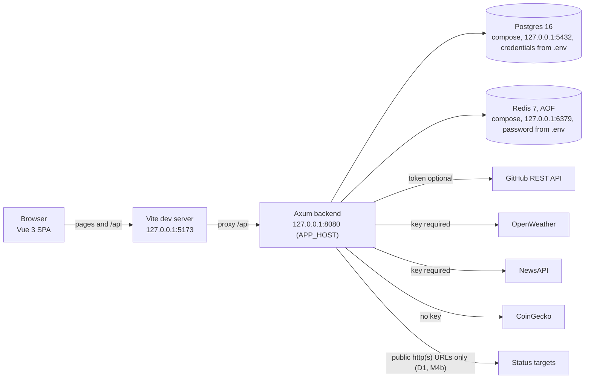
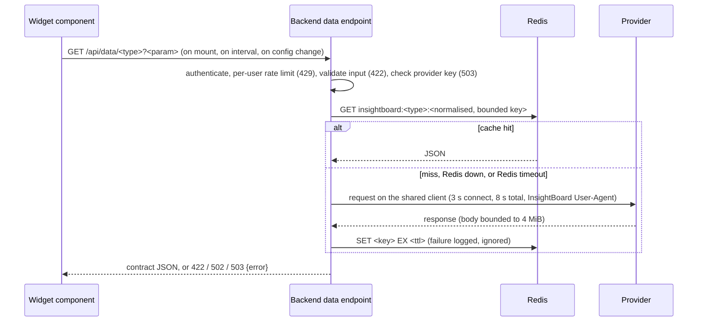

# System overview

The runtime shape of InsightBoard as built at `f15c6a3` (M0–M3) with the M4 changes and the M5 release packaging, and
the boundaries later milestones must preserve or restore. Product direction is in the
[project plan](../../INSIGHTBOARD_PROJECT_PLAN.md) (sections 6–10); status is in the [roadmap](../product/roadmap.md);
the as-built baseline and the defect list are in the [M0–M3 baseline contract](m0-m3-baseline-contract.md); M4 targets
are in the [M4 contract](m4-quality-gate-contract.md) and the release shape in the
[M5 contract](m5-local-release-contract.md).

## Components



- In development the backend and frontend run natively and Postgres and Redis are containers (`docker-compose.yml`).
  The release (M5) is one image built from the root `Dockerfile`: the backend serves the built frontend from
  `STATIC_DIR` with an SPA fallback, and compose runs it under profile `app` on `127.0.0.1:8088` beside the same
  Postgres and Redis (it binds `0.0.0.0:8080` only inside its container). The root `Makefile` runs setup, the
  database, the gates (`make verify`), the Playwright journeys (`make e2e`), and the release (`make release`, `up`,
  `down`, `logs`, `backup`); GitHub Actions runs the backend, web, e2e, and release jobs on every push to `main`.
- In development the browser talks only to the Vite dev server, which proxies `/api` to `http://127.0.0.1:8080`;
  with the release app, pages and `/api` share one origin. The backend also
  grants CORS only to the origins in `CORS_ORIGINS` (default the Vite dev origins `http://127.0.0.1:5173` and
  `http://localhost:5173`; methods GET, POST, PUT, DELETE; headers `Authorization` and `Content-Type`; no
  credentials). A request from any other origin gets no `access-control-allow-origin` header (D4, fixed in M4a).
- Every provider call is made by the backend. Keys live in the backend environment and never reach the browser.
- `GET /healthz` is dependency-free liveness; `GET /readyz` returns 200 `{"status":"ready"}` when Postgres and Redis
  both answer and 503 `{error}` otherwise (D19, M4b).

## Request flows

### Auth

1. `POST /api/auth/register` or `/api/auth/login` with `{email,password}`. Both routes are rate-limited per client
   IP (default 10/min, burst 5; 429 `{error}`). The email is trimmed, lower-cased, and validated (422 otherwise);
   register needs a password of at least 8 characters.
2. The backend hashes (register) or verifies (login) with Argon2 on the blocking pool and returns `{token, user}`;
   the token is an HS256 JWT valid for 24 hours. A duplicate email is 409 (the insert decides, so concurrent
   registrations cannot both succeed). A wrong password and an unknown email are the same 401 `{"error":"Unauthorized"}`,
   and an unknown email still runs one Argon2 verification against a dummy hash.
3. The client stores `auth_token` and `user` in localStorage and treats the session as signed in while the token's
   `exp` claim lies in the future; on start it confirms the session with `GET /api/me`.
4. Every later request carries `Authorization: Bearer <token>`; the `UserCtx` extractor validates it. Every token
   failure is the generic 401; `/me` for a user that no longer exists is 401.
5. A 401 outside login and register, or a stored token past its `exp`, clears the session and opens
   `/login?redirect=<current route>`; after login the client returns to that same-origin path.

### Dashboard save

```mermaid
sequenceDiagram
    participant U as User
    participant E as Editor (DashboardEditorView)
    participant S as Dashboard store
    participant B as Backend
    participant P as Postgres
    U->>E: drag, resize, add (Save), configure, remove, rename
    E->>E: restart 2 s debounce timer
    E->>S: updateDashboard(id, {name, layout})
    S->>B: PUT /api/dashboards/:id {name, layout_json}
    B->>P: UPDATE ... WHERE id AND user_id (validated layout_json)
    B-->>S: 200 dashboard, or 422 {error, details}
    Note over E,S: one save at a time; a failure shows "not saved" with Retry and keeps the edits; leaving flushes once
```

New dashboards are created from the list with only `name` "New Dashboard"; the server stores `{"widgets":[]}` and
`settings_json = {}`. The client never reads or writes `settings_json`.

### Widget data with cache



Status widget (`/api/data/status?urls=`, D1): at most 10 comma-separated URLs (422 beyond); `http`/`https` only, no
credentials, at most 2048 bytes each. An IP-literal host is checked before connecting; a DNS name is resolved by a
policy resolver that drops every blocked address, so the dialled address is always a checked one. Blocked: loopback,
unspecified/"this network", private (RFC 1918), CGNAT `100.64.0.0/10`, link-local (incl. `169.254.169.254`),
IETF-protocol, documentation, benchmarking, 6to4-relay, multicast, reserved/broadcast; for IPv6 everything outside
`2000::/3` (loopback, ULA incl. `fd00:ec2::254`, link-local, NAT64, multicast) plus `2001::/23`, `2001:db8::/32`,
`2002::/16`, `3fff::/20`; IPv4-mapped addresses are checked as IPv4. Checks run 5 at a time with a 2 s connect and
4 s total timeout, no proxy, and no redirects (a 3xx is that URL's result). Per-URL failures are one of
`invalid_url`, `blocked_address`, `dns_error`, `timeout`, `connect_error`, `request_error`, with `status` and
`response_time_ms` 0. `STATUS_ALLOWED_FIXTURES` (empty by default, development only) admits exact loopback
`ip:port` fixtures.

A server-side request timeout (`REQUEST_TIMEOUT_MS`, default 10 s) ends any request with 504 `{error}`.

## Errors and status codes (M4b)

Every error body is JSON `{"error": string}`; 422 adds `details: [{field, message}]` with `field` the request
field (dotted for nested JSON, e.g. `layout_json.widgets.0.w`) or the query parameter name. Shapes:
`ErrorResponse` and `ValidationErrorResponse` in `contracts/api-contract.v1.json`.

| Status | When |
| --- | --- |
| 400 | Malformed JSON body |
| 401 | Missing, invalid, or expired token; `/me` or dashboard create for a deleted user; wrong login (always `Unauthorized`) |
| 404 | Unknown or foreign dashboard (also an unparsable id); unknown route |
| 405 | Method not allowed on a known route |
| 409 | Duplicate email on register; creating a 101st dashboard |
| 413 | Body over the 2 MB extractor limit |
| 415 | Missing or non-JSON `Content-Type` on a JSON route |
| 422 | Well-formed but invalid input: missing/mistyped fields, invalid email, short password, invalid GitHub username, blank dashboard name, layout/settings not matching the contract, more than 10 status URLs, blank or over-long query values |
| 429 | Rate limit exceeded |
| 500 | Database or internal failure (generic text) |
| 502 | Provider failure, timeout, or undecodable response (always `External service error`) |
| 503 | Provider key not configured (weather, news); `/readyz` with Postgres or Redis down |
| 504 | Server request timeout |

## Data model

| Table | Columns | Notes |
| --- | --- | --- |
| `users` | `id` uuid pk, `email` unique, `password_hash`, `created_at` | Emails stored trimmed and lower-cased (migration 003 normalised existing rows unless that would collide) |
| `dashboards` | `id` uuid pk, `user_id` fk → users (cascade), `name`, `layout_json` jsonb default `'{"widgets":[]}'`, `settings_json` jsonb default `'{}'`, `created_at`, `updated_at` | Every query filters by `user_id`; JSON shapes validated on write; at most 100 per user (409) |

Migrations are embedded in the binary and applied at startup. Widget configuration lives inside `layout_json`;
there is no widget table.

## Cache keys and TTLs

| Endpoint | Key | TTL | Client refresh |
| --- | --- | --- | --- |
| `/api/data/github` | `insightboard:github:{lower-cased username}` | 300 s | 300 s |
| `/api/data/weather` | `insightboard:weather:{trimmed, whitespace-collapsed, lower-cased city}` | 600 s | 600 s |
| `/api/data/news` | `insightboard:news:{normalised topic}` | 900 s | 900 s |
| `/api/data/crypto` | `insightboard:crypto:{sorted, de-duplicated, lower-cased ids}` | 300 s | 60 s (D27) |
| `/api/data/status` | `insightboard:status:{user id}:{hash of the URL list}` | 120 s | 120 s |

A key part longer than 100 bytes or containing characters outside `[a-z0-9._,-]` is replaced by a 128-bit hash, so
keys are bounded. Provider data is shared across users; status results are per user (D29). Redis is optional at
startup and per request: one reused connection (`ConnectionManager`) with a 1 s connect and 0.5 s response timeout;
any failure is a cache miss with a warning, and after a failed connect Redis is skipped for 5 s (D19).

## Auth and session

- Local accounts only; no refresh token, revocation, roles, or Cognito.
- Tokens carry `sub`, `email`, `exp`, `iat` and last 24 hours; `JWT_SECRET` shorter than 32 bytes stops startup.
- The client checks the token's `exp` before each request and on navigation, and confirms the session with `/me`
  on start (D23, fixed in M4c).

## Configuration

Backend variables and defaults are documented in `.env.example` and [local setup](../development/local-setup.md).
Required: `DATABASE_URL`, `REDIS_URL`, `JWT_SECRET` (at least 32 bytes). Optional provider credentials:
`GITHUB_API_TOKEN`, `OPENWEATHER_API_KEY`, `NEWSAPI_API_KEY`. Optional M4b settings: provider base URLs
(`GITHUB_API_BASE_URL`, `OPENWEATHER_API_BASE_URL`, `NEWSAPI_API_BASE_URL`, `COINGECKO_API_BASE_URL`), timeouts
(`PROVIDER_CONNECT_TIMEOUT_MS`, `PROVIDER_TIMEOUT_MS`, `STATUS_CONNECT_TIMEOUT_MS`, `STATUS_TIMEOUT_MS`,
`REQUEST_TIMEOUT_MS`), `STATUS_ALLOWED_FIXTURES`, and rate limits (`AUTH_RATE_LIMIT_PER_MINUTE`,
`AUTH_RATE_LIMIT_BURST`, `DATA_RATE_LIMIT_PER_MINUTE`, `DATA_RATE_LIMIT_BURST`). Frontend: `VITE_API_URL` (default
`/api`). `CORS_ORIGINS` (optional, comma-separated exact origins) sets the CORS allowlist. Any unparsable value stops
startup with an error naming the variable. The backend loads `.env` before tracing starts, so `RUST_LOG` in `.env`
applies (D18, fixed in M4a).

## Ports and binds

| Service | Port | Bind | Credentials |
| --- | --- | --- | --- |
| Backend (axum) | 8080 (`APP_PORT`) | `APP_HOST`, default `127.0.0.1` (`backend/src/config.rs`) | API only |
| Postgres | 5432 | `127.0.0.1:5432` (`docker-compose.yml`) | `POSTGRES_USER` / `POSTGRES_PASSWORD` from `.env` |
| Redis | 6379 | `127.0.0.1:6379` (`docker-compose.yml`) | `REDIS_PASSWORD` from `.env` |
| Vite dev server | 5173 | `127.0.0.1` (`frontend/vite.config.ts`) | n/a |

M4 decision 4 (owner-approved 2026-10-10) landed these loopback binds and credentials as the B0 mitigation for
**D3** in `354e06c`; drill B0 observed loopback-only listeners on this workstation the same day. Setting `APP_HOST`
to a non-loopback address is a deliberate owner-approved change and is not blocked by code. CORS is an allowlist
(D4, decision 7, M4a). The compose containers have no fixed names and the network is project-scoped, so a second
checkout can run its own stack (the published ports are still `127.0.0.1:5432` and `:6379`, so two stacks cannot run
at once without changing them).

## Boundaries

Enforced by code:

- Dashboards are owner-scoped in every query; a foreign id returns 404.
- Provider keys stay in the backend; responses are mapped to the contract before reaching the client. The NewsAPI
  key travels in `X-Api-Key`; OpenWeather accepts the key only as a query parameter, so request URLs are never logged
  and reqwest errors are logged `without_url()`.
- Error bodies carry no database, provider, or library text, no URL, and no JWT error kind.
- Outbound requests are limited by scheme, address class, count, concurrency, and time; user input is encoded with
  path-segment and query builders; GitHub usernames follow GitHub's rules (D1, D2, D5, D7, M4b).
- No live providers in automated paths; tests use local mocks with configurable base URLs (D11 backend part, M4b).
- Rate limits on auth routes (per IP) and `/api/data/*` (per user) (D6, M4b).

## Known gaps

By area; each ID is defined in the [baseline contract](m0-m3-baseline-contract.md) section 12.

| Area | Defect IDs |
| --- | --- |
| Exposure and CORS | D3 (fixed 2026-10-10), D4 (fixed in M4a) |
| Outbound calls | D1, D2, D5, D7, D20, D30 (M4b) |
| Abuse and load | D6 (M4b) |
| API correctness and contract | D8, D15, D16, D17 (M4b: backend `jsonschema` and frontend ajv contract tests) |
| Configuration, cache, health | D18 (fixed in M4a), D19 (M4b), D29 (compose part fixed in M4a; cache keys and dashboard cap M4b) |
| Build, gates, dependencies | D12, D13, D14, D26 (fixed in M4a; daisyUI stable 5 in M4c) |
| Tests | D11 (fixed: backend suites in M4b; Vitest, Playwright, and CI in M4c) |
| Frontend editor and session | D9, D10, D22, D23, D28 (fixed in M4c) |
| Styling, accessibility, copy | D24, D25, D27, D31 (fixed in M4c; keyboard layout editing in the backlog) |
| Cloud readiness | D21 |

## Future seams (planned)

- **M5 — Local release (accepted 2026-10-10):** one image with the backend serving the built frontend, a compose profile
  bound to loopback, the runbook, and version `1.0.0`; see the [M5 contract](m5-local-release-contract.md) and the
  [runbook](../operations/runbook.md).
- **M6 — AWS readiness (planned):** a Lambda-compatible packaging seam (for example a `lambda_http` adapter behind a
  feature), synth-only IaC (tool chosen by the owner), a Cognito-compatible auth seam unless deferred, and TLS
  features for sqlx and redis (D21). Nothing is deployed and no AWS credentials are used.
- No seam for the unscheduled backlog (background refresh, public dashboards, AI widget, S3 uploads) exists or is
  planned until the owner schedules it.
